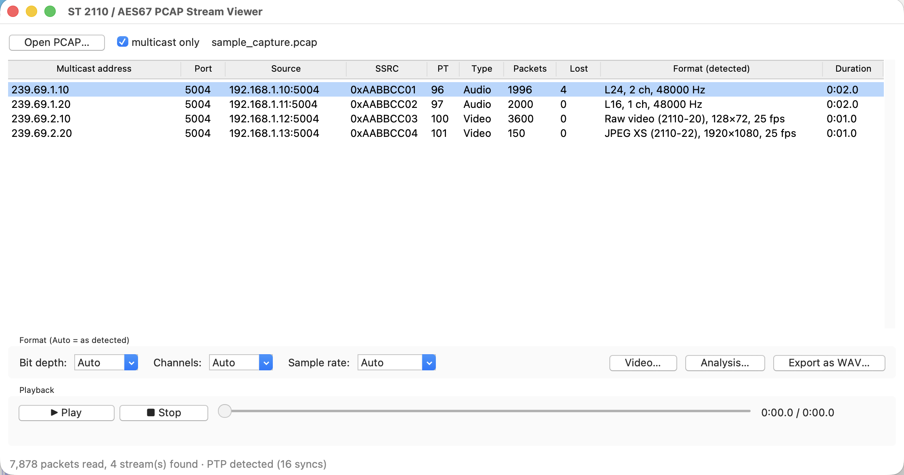
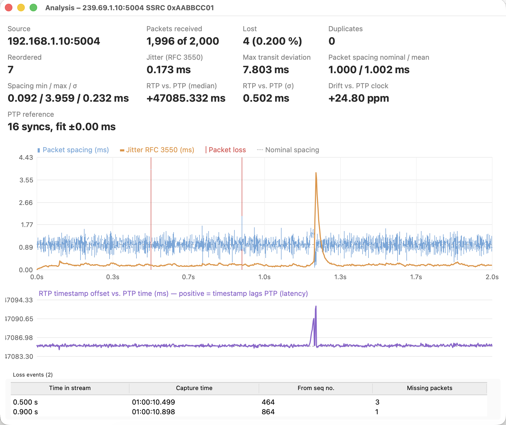
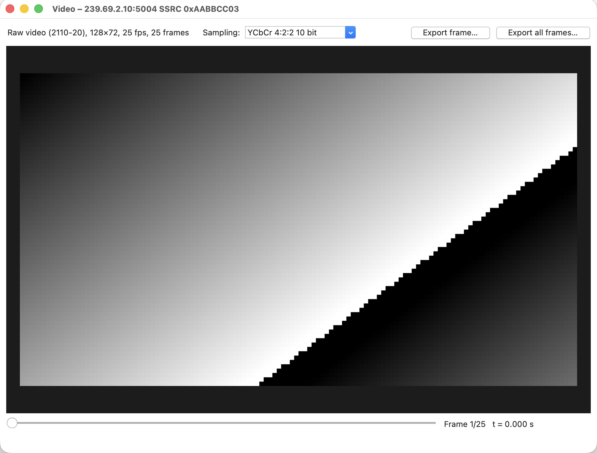

# ST 2110 / AES67 PCAP Stream Viewer


**Downloads:** Ready-made builds for macOS (Apple Silicon + Intel) and Windows
are produced automatically by GitHub Actions — for every release under
[Releases](https://github.com/Gemini2350/ST2110-AES67-Stream-Viewer/releases),
intermediate builds as artifacts of the
[action runs](https://github.com/Gemini2350/ST2110-AES67-Stream-Viewer/actions).

A GUI tool that extracts AES67 audio and ST 2110 video streams from
`.pcap`/`.pcapng` captures (e.g. from Wireshark):

- Lists all detected streams by **multicast address**, port, SSRC and payload type
- **Audio (AES67 / 2110-30/-31):** format detection (L16/L24, channels, sample
  rate — overridable), **WAV export**, **playback** with play/pause and seek bar
- **Uncompressed video (2110-20, RFC 4175):** resolution/frame rate detected
  from the payload headers, frame preview with scrubbing, export as **PNG**
  (selectable sampling: YCbCr 4:2:2 10/8 bit, RGB 8 bit)
- **JPEG XS (2110-22 / IPMX, RFC 9134):** detection incl. resolution from the
  picture header, frame export as **.jxs** codestreams; preview/PNG additionally
  when an FFmpeg with JPEG XS decoding is installed
- **Analysis** per stream (audio and video): packet loss from RTP sequence
  numbers (event list with time and count), RFC 3550 jitter, packet spacing
  statistics and a timing graph
- **PTP comparison:** if the capture contains PTP Sync/Follow_Up messages
  (UDP 319/320 or layer 2), the grandmaster time is reconstructed and each
  stream's RTP timestamps are compared against the PTP clock
  (median/σ/drift in ppm + graph) — instantly shows whether a sender is
  PTP-locked
- Packet loss is flagged and filled with silence on export/playback,
  reordered packets are re-sorted correctly (RTP sequence/timestamp)

Runs on **macOS and Windows** (and Linux), Python ≥ 3.9 with tkinter.

## Screenshots

Stream list — every RTP/AES67/ST 2110 flow by multicast address, source, SSRC,
detected format and PTP status:



Per-stream analysis — packet loss, RFC 3550 jitter, packet-spacing and the
RTP-timestamp-vs-PTP comparison, with a timing graph and a loss-event list:



Video preview — decode and scrub ST 2110-20 frames (and export as PNG / .jxs):



## Running from source

- **macOS:** double-click `run.command` (or `./run.command` in a terminal).
  On first start a local Python environment with `sounddevice` (for playback)
  is created automatically.
- **Windows:** double-click `run.bat`.
- **Directly:** `python3 aes67_pcap_to_wav.py` — without the `sounddevice`
  package only playback is disabled, export always works.

If tkinter is missing (Homebrew Python): `brew install python-tk`

## Command line

```
python3 aes67_pcap_to_wav.py capture.pcap --list
python3 aes67_pcap_to_wav.py capture.pcap --export 1 out.wav [--bits 24] [--channels 2] [--rate 48000]
python3 aes67_pcap_to_wav.py capture.pcap --analyze 1   # loss/jitter/PTP analysis
python3 aes67_pcap_to_wav.py capture.pcap --export-frames 3 frames/ [--frames 0-24] [--sampling 422-10]
```

A synthetic test capture (audio + video + PTP) can be generated with
`python3 make_test_pcap.py test.pcap test.pcapng`.

## Building standalone apps locally

PyInstaller cannot cross-compile: build the `.app` on a Mac,
the `.exe` on a Windows machine. (Or let GitHub Actions do it — see above.)

- **macOS:** double-click `build.command` → `dist/ST2110 AES67 Stream Viewer.app`.
  The script also handles `xattr -cr` + ad-hoc `codesign` (without which
  macOS refuses to launch the app).
- **Windows:** install Python from python.org (check "Add to PATH"),
  then double-click `build.bat` → `dist/ST2110 AES67 Stream Viewer.exe`.

**Mac App Store:** the full process is described in [APPSTORE.md](APPSTORE.md)
(`build_appstore.command` produces the sandboxed, signed store build as .pkg).

Notes on distributing to others:

- **macOS:** The ad-hoc signature is fine for your own machine. On other Macs,
  Gatekeeper blocks downloaded apps → right-click → "Open" once (or run
  `xattr -cr` on the app). The clean solution requires an Apple Developer
  certificate + notarization. An Apple Silicon build does not run on Intel
  Macs and vice versa.
- **Windows:** SmartScreen warns about unsigned downloaded EXEs →
  "More info" → "Run anyway".

## Notes

- AES67 does not carry channel count/bit depth in the stream itself (that
  lives in the SDP). The tool guesses from packet size and RTP timestamps;
  in ambiguous cases (e.g. 6 bytes/frame = L24 stereo *or* L16 3-channel)
  L24 is preferred — correct it via the format selectors.
- Supports IPv4/UDP (Ethernet, VLAN tags, Linux cooked capture, loopback).
- Unicast RTP streams are detected as well (untick "multicast only").
- 2110-20: the sampling is not in the stream (only in the SDP) — the default
  assumption is YCbCr 4:2:2 10 bit (BT.709). Interlaced streams are not
  deinterlaced (both fields land in the same image).
- JPEG XS: decoding requires an FFmpeg with JPEG XS support (e.g. a build
  with SVT-JPEG-XS). Without FFmpeg, .jxs codestreams are exported for
  external decoding — instructions are written next to every export.
- HDCP-encrypted IPMX streams cannot be analyzed, by design.
- PTP comparison accuracy is limited by the capture host's timestamping
  (software timestamps: typically tens of µs to ms).
